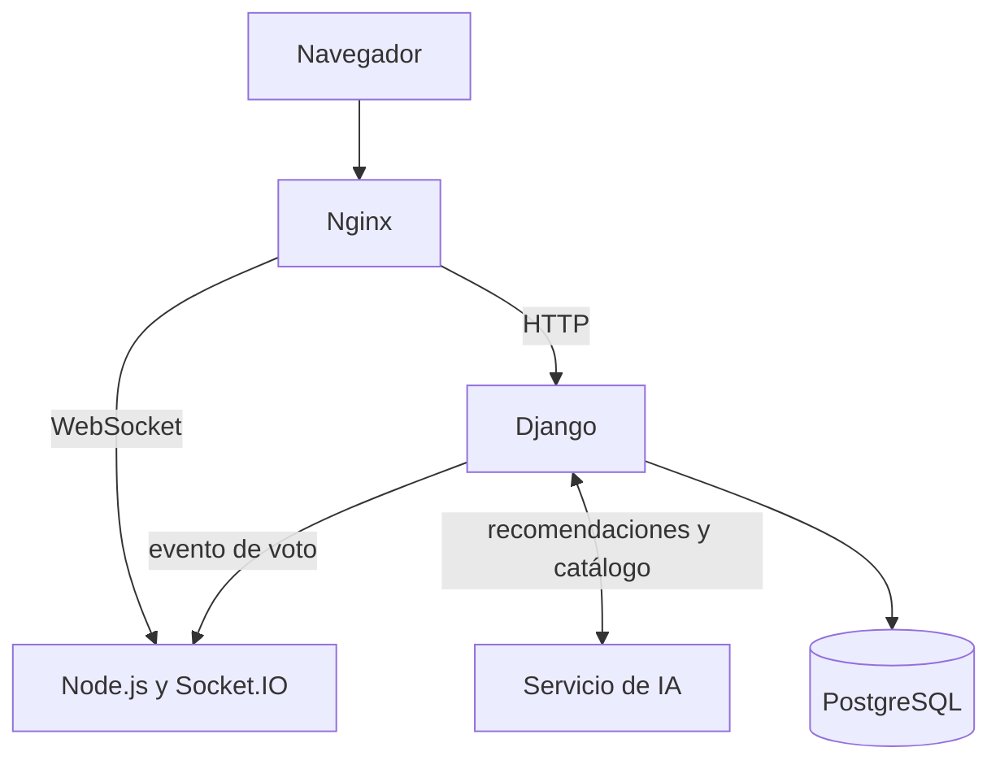

# Biblioteca Inteligente

Catálogo web de una biblioteca, con votos de los lectores. El proyecto evolucionará hacia votos en tiempo real y recomendaciones por inteligencia artificial.

Proyecto de la asignatura Electiva V, Entrega 1.

## Estado actual

| Parte | Estado |
| --- | --- |
| Catálogo, votos y panel de administración en Django | Construido |
| Pruebas automatizadas | Construido |
| Integración continua con GitHub Actions | Configurado |
| Docker Compose con Django y PostgreSQL | Configurado |
| Usuarios y API REST | Planificado |
| Servicio en tiempo real con Node.js | Planificado |
| Servicio de IA con FastAPI | Planificado |
| Nginx | Planificado |

## Arquitectura objetivo



## Ejecución local

```bash
python -m venv venv
```

Activa el entorno. En Windows usa `venv\Scripts\activate`; en Linux o macOS usa `source venv/bin/activate`.

```bash
pip install -r requirements.txt
```

```bash
python manage.py migrate
```

```bash
python manage.py loaddata catalogo_inicial
```

```bash
python manage.py runserver
```

La aplicación queda en <http://127.0.0.1:8000/>. Para entrar a `/admin/`, crea primero un usuario con `python manage.py createsuperuser`.

## Ejecución con Docker

Copia `.env.example` como `.env`, cambia las claves y ejecuta:

```bash
docker compose up --build
```

```bash
docker compose exec web python manage.py loaddata catalogo_inicial
```

## Pruebas

```bash
python manage.py test
```

## Documentación

- Documento SRS: *agregar el enlace*
- Video de presentación: *agregar el enlace*

## Integrantes

- *Por completar*
