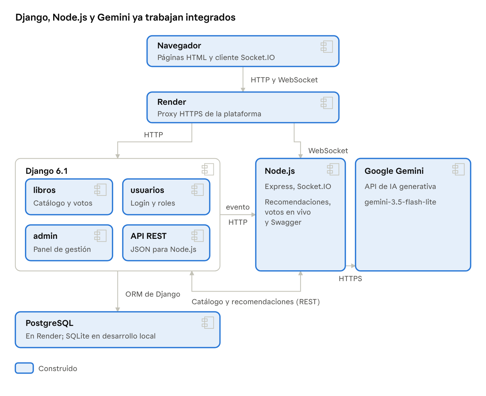

# Biblioteca Inteligente

Catálogo web de una biblioteca con usuarios, roles, votos en tiempo real, recomendaciones y búsqueda en lenguaje natural con inteligencia artificial generativa.

Proyecto de la asignatura Electiva V. Estado: Entrega 3, integración de microservicios e IA.

- **Aplicación publicada:** <https://biblioteca-inteligente-glj7.onrender.com>
- **Swagger del microservicio:** *agregar la URL de Render seguida de `/docs/`*

## Estado actual

| Parte | Estado |
| --- | --- |
| CRUD del catálogo, registro, login y roles en Django | Construido |
| Panel de administración de Django | Construido |
| API REST del catálogo (`/api/libros/`) | Construido |
| Microservicio Node.js con Express y Socket.IO | Construido |
| Documentación pública con Swagger/OpenAPI | Construido |
| Recomendaciones y búsqueda con Google Gemini | Construido |
| Votos y avisos en tiempo real | Construido |
| Docker Compose con Django, Node.js y PostgreSQL | Construido |
| 58 pruebas automatizadas con GitHub Actions | Construido |

## Roles

| Rol | Puede |
| --- | --- |
| Visitante | Ver el catálogo, recibir recomendaciones y buscar con IA |
| Lector | Lo anterior y votar una vez por libro. Toda cuenta nueva queda como Lector |
| Bibliotecario | Lo anterior y agregar, editar y eliminar libros. Lo asigna el Administrador en el panel |
| Administrador | Todo, incluido el panel de Django en `/admin/` |

## Arquitectura



| Servicio | Carpeta | Puerto local | Responsabilidad |
| --- | --- | --- | --- |
| `web` | raíz del proyecto | 8000 | Django: interfaz, usuarios, roles y API REST |
| `microservicio` | `microservicio/` | 3000 | Node.js: IA generativa, Swagger y eventos en vivo |
| `db` | imagen `postgres:17` | interno | PostgreSQL |

## API del microservicio

La documentación interactiva está en `/docs/` y el documento OpenAPI en `/openapi.json`.

| Método | Ruta | Descripción |
| --- | --- | --- |
| `GET` | `/health` | Estado del microservicio |
| `POST` | `/api/recomendaciones` | Recomienda libros parecidos con IA |
| `POST` | `/api/busqueda` | Busca libros con una frase en lenguaje natural |
| `POST` | `/api/eventos/voto` | Django publica un voto (requiere token) |
| `POST` | `/api/eventos/libro` | Django publica un libro nuevo (requiere token) |

## Ejecución con Docker Compose

Requiere Docker Desktop y una clave de [Google AI Studio](https://aistudio.google.com/apikey).

1. Copia `.env.example` como `.env`.
2. Cambia las claves y pega tu `GEMINI_API_KEY`.
3. Levanta los servicios:

```bash
docker compose up --build
```

La aplicación queda en <http://localhost:8000/> y Swagger en <http://localhost:3000/docs/>.

## Ejecución local sin Docker

```bash
pip install -r requirements.txt
```

```bash
python manage.py migrate
```

```bash
python manage.py cargar_catalogo_inicial
```

```bash
python manage.py runserver
```

Sin las variables `NODE_SERVICE_URL` y `NODE_PUBLIC_URL`, Django funciona igual y oculta las funciones de IA.

## Despliegue en Render

El archivo [render.yaml](render.yaml) define Django, el microservicio y PostgreSQL. Cada envío a la rama `main` publica una nueva versión. Estas variables se escriben en el panel de Render:

| Servicio | Variable | Valor |
| --- | --- | --- |
| `biblioteca-microservicio` | `GEMINI_API_KEY` | Clave de Google AI Studio |
| `biblioteca-inteligente` | `NODE_SERVICE_URL` | URL pública del microservicio |

## Ramas

- `main`: versión publicada en Render.
- `develop`: integración del trabajo en curso.

## Pruebas

```bash
python manage.py test
```

```bash
npm --prefix microservicio test
```

## Documentación

- [Documento SRS (PDF)](docs/SRS-Biblioteca-Inteligente.pdf)
- [Video Entrega 1](https://www.youtube.com/watch?v=1tX8ytETkqM)
- Video Entrega 2: *agregar el enlace*
- Video Entrega 3: *agregar el enlace*

## Integrantes

- David Humberto Mahecha Cardozo
- Edilson Mirllan Suarez Gutiérrez
