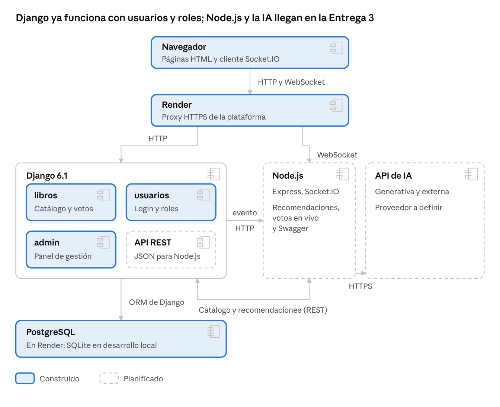

# Biblioteca Inteligente

Catálogo web de una biblioteca con registro de usuarios, roles y votos. En la Entrega 3 se suman un microservicio en Node.js y recomendaciones con inteligencia artificial generativa.

Proyecto de la asignatura Electiva V. Estado: Entrega 2, núcleo funcional.

- **Aplicación publicada:** <https://biblioteca-inteligente-glj7.onrender.com>

## Estado actual

| Parte | Estado |
| --- | --- |
| CRUD del catálogo en Django | Construido |
| Registro, inicio y cierre de sesión | Construido |
| Roles Lector, Bibliotecario y Administrador | Construido |
| Un voto por usuario y libro | Construido |
| Panel de administración de Django | Construido |
| 31 pruebas automatizadas con GitHub Actions | Construido |
| Contenedor Docker con Gunicorn y WhiteNoise | Construido |
| Despliegue en Render con PostgreSQL | Publicado |
| Docker Compose con Django y PostgreSQL | Configurado |
| API REST, microservicio Node.js y Swagger | Entrega 3 |
| Integración con IA generativa | Entrega 3 |

## Roles

| Rol | Puede |
| --- | --- |
| Visitante | Ver géneros, libros y su detalle |
| Lector | Lo anterior y votar una vez por libro. Toda cuenta nueva queda como Lector |
| Bibliotecario | Lo anterior y agregar, editar y eliminar libros. Lo asigna el Administrador en el panel |
| Administrador | Todo, incluido el panel de Django en `/admin/` |

## Arquitectura



Los recuadros punteados se construyen en la Entrega 3. El detalle de la arquitectura está en el SRS.

## Ejecución local

```bash
python -m venv venv
```

Activa el entorno. En Windows usa `venv\Scripts\activate`; en Linux o macOS usa `source venv/bin/activate`.

```bash
pip install -r requirements.txt
```

```bash
python manage.py migrate
```

```bash
python manage.py cargar_catalogo_inicial
```

```bash
python manage.py createsuperuser
```

```bash
python manage.py runserver
```

La aplicación queda en <http://127.0.0.1:8000/>. Para crear un Bibliotecario, entra a `/admin/` con el superusuario, abre el usuario y agrégalo al grupo **Bibliotecario**.

## Ejecución con Docker

Copia `.env.example` como `.env`, cambia las claves y ejecuta:

```bash
docker compose up --build
```

Al arrancar, el contenedor aplica las migraciones, carga el catálogo si la base está vacía y crea el superusuario definido en `.env`.

## Despliegue en Render

El archivo [render.yaml](render.yaml) crea el servicio web desde el `Dockerfile` y una base de datos PostgreSQL gratuita.

1. En Render, elige **New → Blueprint** y conecta este repositorio.
2. Escribe `DJANGO_SUPERUSER_USERNAME`, `DJANGO_SUPERUSER_EMAIL` y `DJANGO_SUPERUSER_PASSWORD` cuando Render los pida.
3. Cada envío a la rama `main` publica una nueva versión.

## Ramas

- `main`: versión publicada en Render.
- `develop`: integración del trabajo en curso.

## Pruebas

```bash
python manage.py test
```

## Documentación

- [Documento SRS (PDF)](docs/SRS-Biblioteca-Inteligente.pdf)
- [Video Entrega 1](https://www.youtube.com/watch?v=1tX8ytETkqM)
- Video Entrega 2: *agregar el enlace*

## Integrantes

- David Humberto Mahecha Cardozo
- Edilson Mirllan Suarez Gutiérrez
